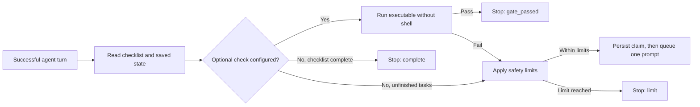

# NotYetDone

**Bounded, evidence-aware continuation for coding agents.**

[Русский](README.ru.md) · [MIT license](LICENSE) · [Design decisions](docs/DECISIONS.md) · [Verification evidence](state/STATUS.md)

NotYetDone is an **OpenCode V2 plugin** that keeps an authorized task moving
inside the same session. After a successful agent turn, it reads a Markdown
checklist and queues a continuation if work remains. It does not mistake a
checked box for proof that the requirements have passed.

**Status:** experimental, source installation only. Windows is the verified
platform; Linux/macOS plugin smoke tests have not been performed. Tested with
OpenCode 2.2.1 and `@opencode/plugin` 2.2.0. No npm release.

## Why this project

Agents sometimes stop after describing their next step instead of executing it.
A naive loop solves that by repeatedly prompting, but introduces duplicate
messages, endless retries and cancellation races. This project focuses on those
failure modes rather than adding another autonomous supervisor.

- **Single continuation owner:** repeated plugin loads deactivate the previous
  event consumer without removing tools from other OpenCode contexts.
- **Replay protection:** durable event identities and a persisted prompt claim
  prevent repeat delivery from queuing the same continuation twice.
- **Bounded execution:** 12 continuations, unchanged-checklist limits and
  tool-activity stagnation detection.
- **Explicit recovery:** pause, resume without resetting counters, and a separate
  `blocked_external` state with a concrete reason.
- **Optional verification gate:** a user-supplied executable decides completion;
  a failing check can continue even when all boxes are checked.
- **Compaction recovery:** saved task context joins the next continuation, not
  an extra prompt.

## How it works



Interruption, failure or an explicit pause disables continuation. Revocation of
an already queued prompt is best-effort and depends on runtime API support.

## Install on Windows

Requirements: Git, **Node.js 22+**, npm, Windows PowerShell 5.1+ or PowerShell 7,
and OpenCode V2. Use a disposable session for the first smoke test.

```powershell
git clone https://github.com/kwexz/NotYetDone.git
cd NotYetDone
npm ci
npm test
npm run check
powershell -NoProfile -File scripts/install.ps1
```

The installer copies the three runtime modules into
`%USERPROFILE%\.config\opencode\plugins\task-continuity`, creates a plugin
package manifest if absent and installs dependencies if missing. It does not alter your model
or permissions. Review an existing target directory before installing: runtime
files will be replaced; an existing manifest is preserved.

**Restart the OpenCode server**, not only its Desktop window. Save other work
first: the shared server may serve multiple sessions. See the V2
[service documentation](https://opencode.ai/v2/docs/cli) for your installation.

To uninstall, close the server and remove only the installed
`task-continuity` directory. Plugin state and project files are not removed.

## Use

Create a project-relative `tasks.md`:

```markdown
- [ ] Implement the requested behavior
- [ ] Run tests and record evidence
```

Ask the agent to enable `task_continuity` for this file, or enter:

```text
/continuity on tasks.md
/continuity status
/continuity off
```

The slash shorthand is translated into a tool request by the plugin. Confirm
the tool result rather than assuming the text alone enabled it.

Equivalent tool inputs:

```json
{"action":"enable","path":"tasks.md"}
```

```json
{"action":"status"}
```

Use `pause` to stop, `resume` to reactivate saved control without resetting
counters, or `block` with a `reason` for an external dependency. Public phases:
`active`, `paused`, `blocked_external`, `complete`, `limit`, `error`, `gate_passed`.

### Opt-in verification

Only provide a check when you explicitly authorize the command:

```json
{"action":"enable","path":"tasks.md","check":{"file":"node","args":["--test","test/gate.test.mjs"],"cwd":".","timeoutMs":120000,"maxOutput":8000}}
```

`file` is a command name in PATH or a project-relative executable; `cwd` must
stay inside the project. Windows `.cmd`/`.bat` files are rejected: use an
executable directly, for example `node` with a script argument.

Exit 0 stops the loop unless execution timed out or output exceeded the limit.
Other results continue with a capped output tail, subject to safety limits.
`status.lastCheck` includes code, duration, timeout and truncation information.
Commands are **never extracted from Markdown**.

## Safety and limitations

- No telemetry, external keys or network calls in plugin runtime code. A check
  is **not sandboxed** and can use your filesystem, network and user privileges.
- Does not change the user's model, permissions or project source code.
- A checked checklist and a passing command are not universal acceptance proof.
- In tested OpenCode 2.2.1, `session.inbox.cancel` was unavailable: an already
  queued prompt may still arrive after pause.
- Ownership is process-local; multiple independent servers are not protected by
  an atomic cross-process lock.
- Long-limit and live compaction runs remain unverified. macOS testing is not
  planned. Linux testing of an alternative tool is not a Linux plugin E2E.

## Engineering and verification

The local suite contains **33 passing tests**: pure policy tests, fake-context
OpenCode integration tests and real Node child-process tests for the gate.
These are not a substitute for live OpenCode E2E. A recorded Windows smoke
demonstrated two continuations and no extra prompt after checklist completion;
its protocol deviation is documented in [SMOKE.md](state/SMOKE.md).

```text
index.mjs            OpenCode adapter, event lifecycle and prompt claims
policy.mjs           runtime-independent checklist and limit policy
gate.mjs             validated, bounded subprocess execution
test/                regression and integration tests
scripts/install.ps1  Windows source installer
docs/DECISIONS.md    trade-offs and architectural decisions
openspec/specs/      behavior specifications
state/              verification evidence and smoke protocol
```

For portfolio review, start with the owner-replacement, interrupt-during-check
and replay tests in `test/owner.test.mjs`, then read the decisions and evidence.
The focus is event-driven reliability, cancellation and honest verification,
not a claim of production readiness or superiority to other agents.

## Contributing

See [CONTRIBUTING.md](CONTRIBUTING.md) and [SECURITY.md](SECURITY.md).
Licensed under [MIT](LICENSE), copyright 2026 kwexz.
